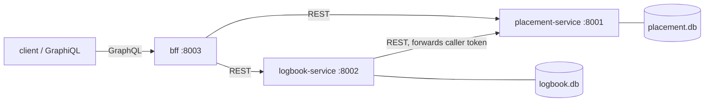

# AttachLog

AttachLog records student internships: the **placement service** owns placements,
the **logbook service** owns weekly entries and reviews, and a **GraphQL BFF**
composes both behind one schema for clients.



## Repository layout

| Path | Purpose |
| --- | --- |
| `placement-service/` | FastAPI service: placements + dev token endpoint, SQLite `placement.db` |
| `logbook-service/` | FastAPI service: weekly entries, reviews, progress, SQLite `logbook.db` |
| `bff/` | Strawberry GraphQL service over the two REST APIs (port 8003) |
| `client/` | Demo client: one GraphQL query, one mutation, one direct REST call |
| `integration-tests/` | End-to-end pytest that starts all three real services |
| `k8s/` | Namespace, ConfigMap, Secret, Deployments, Services, PVCs, probes |
| `docker-compose.yml` | Builds and runs the three services together |

## Prerequisites

- Python 3.14 with `.venv/` at the repo root (dependencies are already installed;
  `requirements-dev.txt` lists them for a fresh machine).
- Docker + Docker Compose for containers, and `kind` (or Minikube) + `kubectl`
  for Kubernetes.

## Run locally

Each service reads SQLite paths relative to its working directory, so start each
one from its own directory. All three must share `JWT_SECRET`.

```powershell
cd placement-service; ..\.venv\Scripts\python.exe -m uvicorn app.main:app --port 8001
cd logbook-service;   ..\.venv\Scripts\python.exe -m uvicorn app.main:app --port 8002
cd bff;               ..\.venv\Scripts\python.exe -m uvicorn app.main:app --port 8003
```

- Placement docs + OpenAPI: http://localhost:8001/docs
- Logbook docs + OpenAPI: http://localhost:8002/docs
- GraphiQL: http://localhost:8003/graphql

Get a dev token (there is no user store; this endpoint is for local demos only):

```powershell
Invoke-RestMethod -Method Post http://localhost:8001/v1/auth/token `
  -ContentType application/json -Body '{"sub":"co-1","role":"coordinator"}'
```

Paste `access_token` into the **Authorize** box on `/docs`, or into the GraphiQL
headers panel as `{"Authorization": "Bearer <token>"}`.

### Environment variables

| Variable | Service | Default |
| --- | --- | --- |
| `JWT_SECRET` | all | `dev-secret-change-me-use-32-chars-min` |
| `JWT_TTL_MINUTES` | placement | `480` |
| `DATABASE_URL` | placement / logbook | `sqlite:///./placement.db` / `./logbook.db` |
| `TERM_START`, `TERM_END` | placement | `2026-09-01`, `2027-02-28` |
| `PLACEMENT_SERVICE_URL` | logbook / bff | `http://localhost:8001` |
| `LOGBOOK_SERVICE_URL` | bff | `http://localhost:8002` |

## REST API

All routes are under `/v1`; every service also exposes `/health`. There are 13
versioned operations. Full examples live in `placement-service/openapi.json`
and `logbook-service/openapi.json` (regenerate after route or schema changes).

| Method | Path | Role | Purpose |
| --- | --- | --- | --- |
| POST | `/v1/auth/token` | none | Dev token for `sub` + `role` |
| POST | `/v1/placements` | coordinator | Create a placement (inside the term) |
| GET | `/v1/placements` | any authenticated | List/filter/paginate placements |
| GET | `/v1/placements/{id}` | any authenticated | Read one placement |
| PUT | `/v1/placements/{id}` | coordinator | Change supervisors (open only) |
| POST | `/v1/placements/{id}/close` | coordinator | Close + final evaluation |
| POST | `/v1/placements/{id}/entries` | student | Submit one week (409 if taken) |
| GET | `/v1/entries` | any authenticated | List entries (`placementId`, `status`) |
| GET | `/v1/entries/{id}` | any authenticated | Read one entry |
| PUT | `/v1/entries/{id}` | student | Revise an entry (approved is locked) |
| POST | `/v1/entries/{id}/reviews` | company supervisor | Approve/reject (assigned only) |
| GET | `/v1/entries/{id}/reviews` | any authenticated | Review history |
| GET | `/v1/placements/{id}/progress` | any authenticated | Completion % + comments |

Roles: `student`, `company_supervisor`, `academic_supervisor`, `coordinator`.
Missing/invalid tokens return **401**; wrong role returns **403**. Errors always
use the same shape:

```json
{"error": {"code": "entry_exists", "message": "An entry already exists for week 1", "details": null}}
```

### Business rules

- One entry per placement per week — a duplicate is **409 `entry_exists`**.
- An approved entry is locked — editing it is **409 `entry_locked`**.
- Only the company supervisor assigned to the placement can review it — otherwise
  **403 `not_assigned_supervisor`**; reviewing a non-pending entry is **409
  `entry_not_pending`**.
- A rejection requires a comment (**422 `comment_required`**).
- Entries outside the placement's week count are **422 `week_out_of_range`**.
- Placement dates must be inside `TERM_START`…`TERM_END` (**422 `outside_term`**).

## GraphQL BFF

Schema highlights (field names are camelCased by Strawberry):

```graphql
type Query {
  placement(id: ID!): Placement
  myEntries(status: EntryStatus, page: Int = 1, pageSize: Int = 10): EntryPage!
}

type Mutation {
  reviewLogEntry(input: ReviewInput!): ReviewResult!
}

type Placement {
  id: ID!
  student: Student!
  company: Company!
  totalWeeks: Int!
  status: String!
  completionPercent: Float!
  entries(status: EntryStatus): [Entry!]!
}
```

Example query with variables:

```graphql
query Placement($id: ID!) {
  placement(id: $id) {
    student { name }
    company { name city }
    totalWeeks
    completionPercent
    entries(status: PENDING) { week hours status }
  }
}
```

```json
{"id": "<placement-id>"}
```

Example mutation with variables (company supervisor token):

```graphql
mutation Review($input: ReviewInput!) {
  reviewLogEntry(input: $input) {
    entry { id week status }
    errors { code message }
  }
}
```

```json
{"input": {"entryId": "<entry-id>", "decision": "APPROVED", "comment": null}}
```

Auth failures return HTTP **401/403** with a GraphQL error carrying
`extensions.code` (`not_authenticated` / `forbidden`). Business errors (e.g.
`entry_not_pending`) are returned in `ReviewResult.errors` and mirror the REST
error codes.

## Demo client

With the three services running locally:

```powershell
.\.venv\Scripts\python.exe client\client.py
```

The client seeds a placement and a week-1 entry through REST, runs the
`placement` query and the `reviewLogEntry` mutation with variables, then makes
one direct REST call (`GET /v1/placements/{id}`). See `client/README.md`.

## Tests

Run each suite from its own directory (code imports `app.*`):

```powershell
cd placement-service; ..\.venv\Scripts\python.exe -m pytest   # 22 tests
cd logbook-service;   ..\.venv\Scripts\python.exe -m pytest   # 37 tests
cd bff;               ..\.venv\Scripts\python.exe -m pytest   # 12 tests
.\.venv\Scripts\python.exe -m pytest integration-tests        # 1 end-to-end test
```

The integration test starts real uvicorn processes on free ports with temporary
SQLite files, then exercises REST business rules, the GraphQL query/mutation,
401/403 cases, and one direct REST call. Set `ATTACHLOG_KEEP_E2E=1` to keep the
service logs in the temp directory.

## Docker Compose

```powershell
docker compose up --build -d
docker compose ps
.\.venv\Scripts\python.exe client\client.py
docker compose down -v
```

Services: placement `:8001`, logbook `:8002`, BFF `:8003`. Data lives in the
`placement-data` and `logbook-data` named volumes. Compose waits for each
service's `/health` check before starting the next one. Override the shared
secret with `$env:JWT_SECRET="..."` before `up`.

## Kubernetes (kind / Minikube)

The manifests use images `attachlog/{placement-service,logbook-service,bff}:1.0.0`
with `imagePullPolicy: IfNotPresent`.

```powershell
# 1. Build the images
docker build -t attachlog/placement-service:1.0.0 placement-service
docker build -t attachlog/logbook-service:1.0.0 logbook-service
docker build -t attachlog/bff:1.0.0 bff

# 2. Load them into a kind cluster (skip for Minikube: use `minikube image load`)
kind create cluster --name attachlog
kind load docker-image attachlog/placement-service:1.0.0 attachlog/logbook-service:1.0.0 attachlog/bff:1.0.0 --name attachlog

# 3. Apply namespace, config, secret, then the services
kubectl apply -f k8s/namespace.yaml
kubectl apply -f k8s/configmap.yaml -f k8s/secret.yaml
kubectl apply -f k8s/placement-service.yaml -f k8s/logbook-service.yaml -f k8s/bff.yaml

# 4. Wait for readiness and inspect probes
kubectl -n attachlog rollout status deploy/placement-service
kubectl -n attachlog rollout status deploy/logbook-service
kubectl -n attachlog rollout status deploy/bff
kubectl -n attachlog get pods
```

`k8s/placement-service.yaml` and `k8s/logbook-service.yaml` also create
ReadWriteOnce PVCs; the Deployments use `strategy: Recreate` because SQLite must
never be opened by two pods. The BFF is stateless and runs 2 replicas.

### Demonstrate one end-to-end request in the cluster

Port-forward the three services (one terminal each) and run the demo client,
which performs the GraphQL query + mutation and a direct REST call:

```powershell
# terminal 1
kubectl -n attachlog port-forward svc/placement-service 8001:8001
# terminal 2
kubectl -n attachlog port-forward svc/logbook-service 8002:8002
# terminal 3
kubectl -n attachlog port-forward svc/bff 8003:8003
# terminal 4
.\.venv\Scripts\python.exe client\client.py
```

Or a single raw request through the BFF:

```powershell
$token = (Invoke-RestMethod -Method Post http://localhost:8001/v1/auth/token `
  -ContentType application/json -Body '{"sub":"as-1","role":"academic_supervisor"}').access_token
Invoke-RestMethod -Method Post http://localhost:8003/graphql `
  -Headers @{Authorization="Bearer $token"} -ContentType application/json `
  -Body '{"query":"query($id:ID!){placement(id:$id){student{name} completionPercent}}","variables":{"id":"<placement-id>"}}'
```

## Notes

- Tables are created with `Base.metadata.create_all()` at import; there are no
  migrations. Delete a local `.db` file after changing a model.
- The token endpoint has no password or user store and must not be exposed in
  production; replace it with a real identity provider.
- `openapi.json` in each service is a generated snapshot. Regenerate it after
  changing routes or auth:

```powershell
cd placement-service; ..\.venv\Scripts\python.exe -c "import json; from app.main import app; open('openapi.json','w',encoding='utf-8').write(json.dumps(app.openapi(), indent=2)+'\n')"
```
